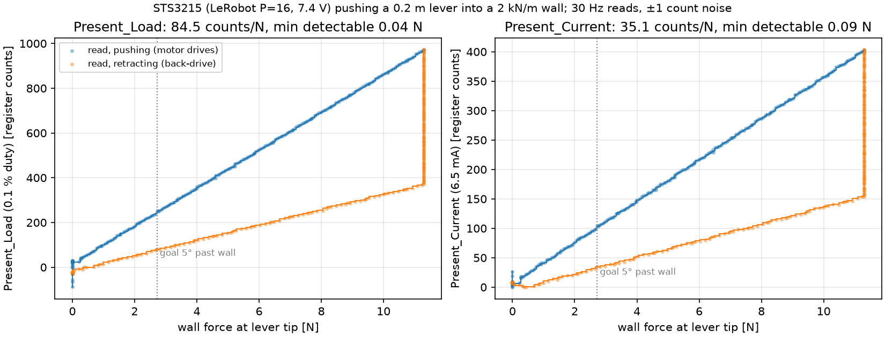

# so101-contact

A simulation model of the Feetech **STS3215** servo used in every SO-101 arm. It reproduces the servo's own
telemetry registers, `Present_Load` (PWM duty) and `Present_Current`, as LeRobot reads them on real hardware, so a
$120 arm with no force sensor has a usable contact signal in simulation with the same encoding on the real arm.

NVIDIA's BAM drive models how a hobby servo *moves*. This package models what it *feels*.

- **Same equations and names as BAM.** Motor and gearbox friction follow Isaac Lab's BAM drive (m5); parameters use
  `BamMotorCfg` names and `to_bam_kwargs()` drops them into BAM on Newton unchanged.
- **Measured parameters.** The default preset is Rhoban BAM's hardware identification of a real STS3215 7.4 V,
  with LeRobot's firmware gains (P = 16). A datasheet-only preset is derived as a cross-check
  ([docs/DERIVATION.md](docs/DERIVATION.md)).
- **Feetech firmware details BAM leaves out.** Goal_Position quantization, the internal target rate limiter, the error
  in encoder counts with a dead zone, the current window and overload protection.
- **Registers byte-compatible with LeRobot.** Sign-magnitude bit 10 for `Present_Load`, raw `Present_Current` in
  6.5 mA counts, read at the control rate with latency, noise and dropout.
- Core is pure torch, batched over `(num_envs, num_joints)`, CPU or GPU, no Isaac imports.

## Install

```bash
pip install -e .            # torch + numpy
pip install -e ".[dev]"     # + pytest, matplotlib
```

## Use

```python
import torch
from so101_contact import SO101_FOLLOWER, STS3215Model, TelemetryBus, randomize

n, dt = 16, 1 / 240
servo = STS3215Model(randomize(SO101_FOLLOWER, n, torch.Generator().manual_seed(0)), n, dt,
                     friction_mode="explicit")
bus = TelemetryBus(n, 6, dt, read_hz=30)

out = servo.step(goal_rad, q, qd, tau_ext)        # every physics step, (n, 6) tensors
apply_joint_torque(out["tau"])                    # your physics engine
regs = bus.step(out["duty"], out["current"], q, qd)
regs["Present_Load"], regs["Present_Current"]    # int64, LeRobot-decoded, LeRobot motor order
```

`friction_mode="physx_joint"` returns the motor torque only and leaves the Coulomb budget
(`out["friction_budget"]`) to the engine's joint friction, as BAM does on MJWarp.

## Results (1-DOF, `examples/push_wall.py`)



A servo with LeRobot gains pushes a 0.2 m lever into a 2 kN/m wall; the goal moves 20° past the wall and back.

| | |
|---|---|
| Present_Load per newton at the tip, pushing | 84.5 counts/N |
| same, wall back-driving the joint | 34.3 counts/N (0.41×) |
| Present_Current per newton, pushing | 35.1 counts/N |
| smallest detectable tip force (3 counts, ±1 count noise) | **0.04 N** (Present_Load), 0.09 N (Present_Current) |
| duty saturation | 10.7 N |

These are single-joint, quasi-static numbers. On the arm, gravity load, arm dynamics and the stiction band between
the two branches (Present_Load 250 vs 80 at 2.7 N) dominate the noise floor: the signal is reliable when the arm
pushes into the contact.

## Derivation

`python -m so101_contact.derive` prints the datasheet derivation next to the BAM fit and checks the datasheet
consistency. Summary: kt and R agree within 5 %; the datasheet stall torque (1.912 N·m) implies more gearbox loss
than the measured unit (2.26 N·m quasi-static stall torque).

## Tests

```bash
pytest -q
```

CPU only, no Isaac Sim. They cover datasheet consistency, stall torque, no-load speed, dead zone, saturation,
current window, overload protection, command delay, register encoding against LeRobot's reference functions,
telemetry latency, monotone load vs force, and the drive/back-drive asymmetry.

## Isaac Lab (PhysX)

```python
from so101_contact.isaaclab.actuator import STS3215Actuator, so101_sts3215_cfg
from so101_contact.isaaclab.observations import servo_load, servo_current

robot_cfg = SO101_CFG.replace(actuators=so101_sts3215_cfg("physx_joint"))   # isaaclab_so101 joint names
...
sim.reset()
STS3215Actuator.bind_all(robot)   # enables the external-torque estimate (M qdd - tau) and PhysX friction writes
```

`physx_joint` writes BAM's Coulomb budget to PhysX joint friction each step (stiction, as on the real gearbox);
`explicit` keeps all friction in the torque (smooth, no stiction, no CPU writes). On the SO-101 hold test
(`patchbench/scripts/hold_test.py`) with LeRobot gains: gravity sag ≤ 1.8°, a 30° shoulder step settles in
0.16–0.33 s without ringing, and Present_Load on shoulder_lift rises linearly with gripper contact force
(≈ 90 counts/N in `physx_joint`). In `physx_joint` the elbow's load stays flat until ~2 N: a joint that is not
moving holds small contact torques in gearbox stiction.

## Real arm (LeRobot)

`so101_contact.lerobot_hw.ServoTelemetryProcessorStep` reads `Present_Load` / `Present_Current` with `sync_read`
and adds `observation.servo_load` / `observation.servo_current`, decoded exactly like the simulated bus.

## Status

v0.1: core model, Isaac Lab actuator and observation terms, LeRobot processor step, and a hardware calibration
protocol ([docs/CALIBRATION_PROTOCOL.md](docs/CALIBRATION_PROTOCOL.md), not yet run on a real arm).

## License

Apache-2.0. BAM parameters and equations: Rhoban BAM (Apache-2.0) and Isaac Lab (BSD-3-Clause).
